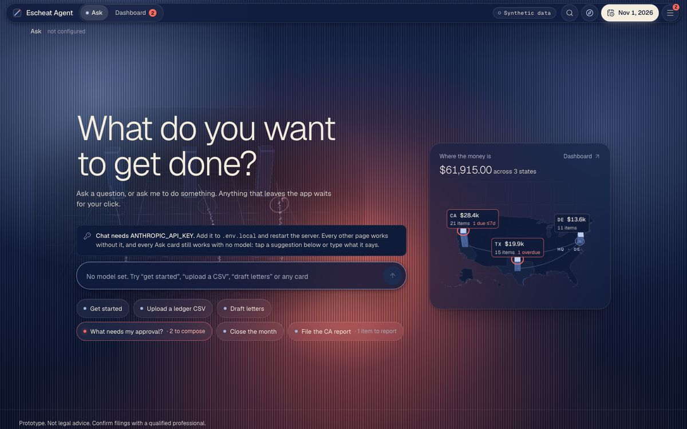
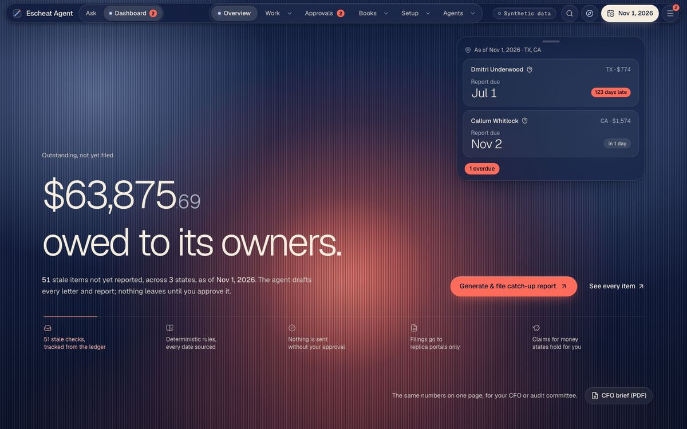
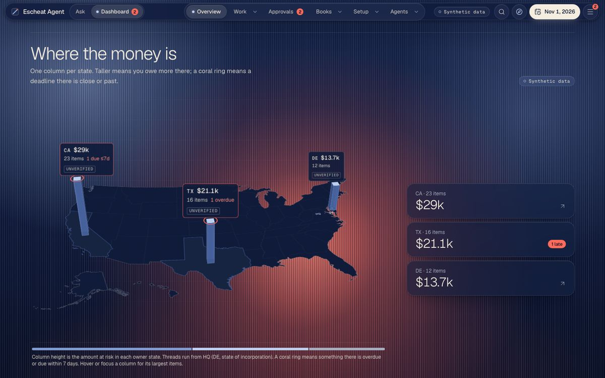
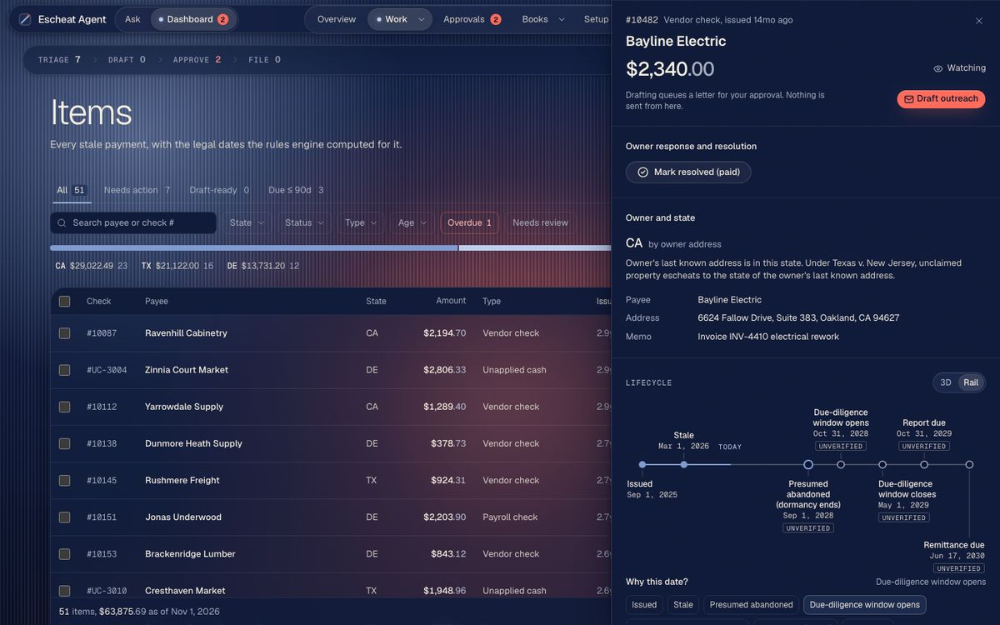
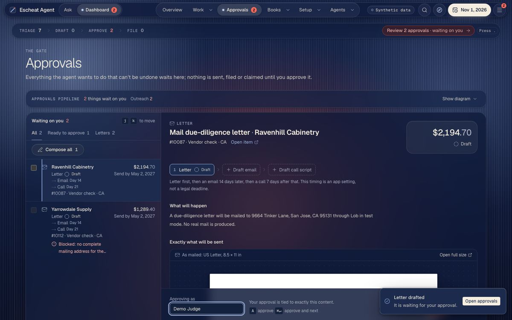
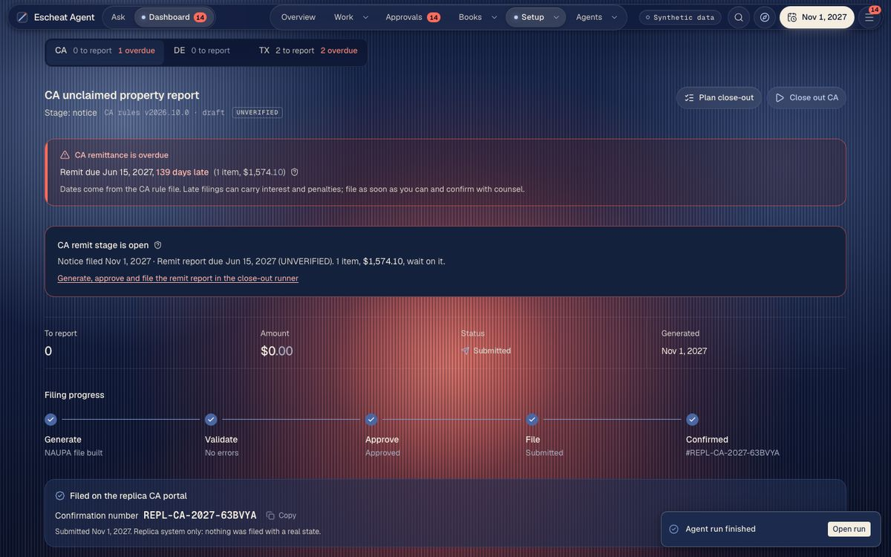

# Escheat Agent

**Every uncashed check is a legal clock. Escheat Agent watches all of them.**

When a company's check goes uncashed or a customer credit sits unused, state unclaimed-property law (escheatment)
eventually requires the company to try to reach the owner, then report and hand the money to the state, on
state-specific deadlines with interest and penalties for missing them. Most finance teams still track this in
spreadsheets. Escheat Agent reads the ledger, finds the stale items, computes every legal deadline from sourced rule
files, drafts the owner letters, builds and validates the state report, files it on a replica state portal, and
searches for money states hold for the company. It does the work, and it stops for a person before anything that cannot
be undone. Built for the BBS x Ramp hackathon. California, Delaware and Texas, on synthetic data.

**Prototype. Not legal advice. Confirm filings with a qualified professional.**

**The model reads, the code decides the law, and a person approves every irreversible step.**



## Quickstart (about 60 seconds, no API keys)

Needs Node 20.9+ and pnpm 12 (`corepack enable` picks up the version pinned in `package.json`).

```bash
git clone <this repo> escheat-agent && cd escheat-agent
pnpm install
pnpm run setup    # creates .env.local, migrates and seeds the local database, prints a checklist
pnpm dev          # then open http://localhost:3000/ask
```

Optional, once: `pnpm exec playwright install chromium`. The filing and recovery agents drive a local headless
Chromium against the replica portals; skip it if you already have Playwright's Chromium.

- Write `pnpm run setup` and `pnpm run doctor` with `run`: pnpm has built-in commands named `setup` and `doctor`.
- `pnpm run setup` is safe to rerun. A rerun re-seeds, which resets the demo. It never prints or overwrites values in
  `.env.local`; it only fills two empty local-only secrets (`OWNER_LINK_SECRET`, `MCP_TOKEN`) with random values.
- `pnpm run doctor` is a read-only health check (Node, pnpm, env var names only, migrations, seed) with a fix-it hint
  for anything missing.
- Reset the demo at any time: stop `pnpm dev`, run `pnpm seed:demo`, start `pnpm dev` again.
- In dev there is no login screen. Set `APP_PASSCODE` in `.env.local` to see the passcode gate (`/login`).

## What works with no keys, and what each key adds

With zero keys the whole product runs on synthetic data: the dashboard, items and their legal timelines, rules,
approvals, letters (composed and approved, not mailed), NAUPA report generation and validation, the filing and recovery
agents on the replica portals, month-end close, the audit chain, the MCP server and the eval. Ask works too: its setup
and action cards (Get started, Upload a ledger CSV, Draft letters, What needs my approval?, Close the month, File the
CA report, What's overdue?, Set up integrations) answer from the database and need no model. Free-form questions are
the only thing that needs a key.

Every key is optional. Without one, that feature shows an honest "not configured" state, never fake data.

| Key (in `.env.local`) | Without it | With it |
|---|---|---|
| `ANTHROPIC_API_KEY` | Ask answers its cards only; free-form questions say "Chat needs ANTHROPIC_API_KEY". The classifier is a labeled keyword heuristic; browser agents run a labeled scripted driver | Ask answers any question through 19 server-side tools (Opus 5.5); live Haiku/Opus classifier; Stagehand browser agents (Sonnet 5.5); model eval runs |
| `ESCHEAT_OFFLINE=1` (not a key) | | Replays recorded model calls from `fixtures/cassettes/`: Ask answers the recorded demo prompts (for example "What do we owe and where?", "Explain check #10087") and says "no recorded answer" for anything else. Lob, AgentMail and Vapi become local fakes that say "Offline mode: nothing was sent" |
| `LOB_TEST_API_KEY` | Approve works; Send shows "not configured" | An approved letter is created as a Lob TEST-mode PDF. Keys that do not start `test_` are refused. Nothing is mailed |
| `AGENTMAIL_API_KEY` + `AGENTMAIL_INBOX_ID` + `ALLOWED_TEST_RECIPIENTS` | Email refused as "not configured" | Approved emails go only to allowlisted addresses (`pnpm agentmail:setup` creates the inbox) |
| `VAPI_API_KEY` + `VAPI_PHONE_NUMBER_ID` + `ALLOWED_TEST_PHONES` | Calls refused as "not configured" | Approved calls go only to allowlisted numbers |
| `QBO_*`, `PLAID_*` | CSV import only | QuickBooks Online and Plaid sandbox connections in Settings |
| `DATABASE_URL` | File-backed PGlite in `.data/pglite` | Neon Postgres (needed for any deployment) |
| `INNGEST_*`, `BROWSERBASE_*` | Inngest dev mode locally; local Playwright | Inngest cloud; a hosted browser |

`.env.example` lists every variable, grouped and commented. `pnpm smoke:live` proves each configured service end to
end with real keys, keeping every guard (see "Live check" below).

## Two-minute demo

Run the quickstart, open `http://localhost:3000/ask`. Every number below is from a fresh `pnpm run setup`; the demo date
starts at Nov 1, 2026.

1. **Ask.** The landing asks "What do you want to get done?" and offers starter chips built from real state. Coral
   chips need a person; steel ones only read. The top bar has the **Ask / Dashboard** switch, the demo date and the
   menu (☰) with every page.
2. **Get started.** Click the **Get started** chip. A setup card shows 1 of 4 steps done: ledger loaded (733 rows),
   92 rule values still UNVERIFIED across 3 states, no letter approved, no report filed. No model was used.
3. **Upload a CSV.** Type `Upload a ledger CSV` (or use the chip). Choose `fixtures/synthetic/ask-upload-sample.csv`,
   click **Read columns**, check the suggested column mapping, **Preview rows** (4 valid, 2 rejected with the line and
   reason), then **Import 4 rows**. Nothing is stored until that click.
4. **Dashboard and the Money Map.** Switch to **Dashboard**. The hero reads "$61,915.00 owed to its owners" across 47
   stale items before the import (51 items after it). "Stale" is a 180-day business threshold, not law.
   Top right: the next deadlines, overdue first. Scroll to **Where the money is**: one column per owner state
   (CA, TX, DE), a coral ring where a deadline is close or past. Hover a column for its largest items.
5. **One item, every date sourced.** Click **Work** in the pill nav (it opens Items) and click check **#10482** (Bayline Electric, $2,340.00).
   The drawer's lifecycle shows each legal date (presumed abandoned, due-diligence window, report due, remittance) with
   its rule path, rule version and official source link. Every value carries an UNVERIFIED badge until a person approves
   that rule value under **Setup → Rules**.
6. **Draft and approve a letter.** Open check **#10087** (Ravenhill Cabinetry, whose due-diligence window is open) and
   click **Draft outreach**, then **Review in approvals**. Approvals shows exactly what would be mailed. Type your name
   in **Approving as** and click **Approve**: the approval is bound to a hash of that exact content (editing the draft
   voids it). **Send** then reports Lob "not configured" (or creates a Lob TEST PDF with a test key). Nothing is mailed.
7. **Advance the demo clock.** Click the date in the top bar and choose **+1y**. Durable timelines recompute: items move
   from due diligence to "to report" and the dashboard updates.
8. **File on the replica portal.** Open **Setup → Reports**, pick **CA**, click **Generate report**: a NAUPA II file
   is built and validated, with an evidence pack. The filing agent cannot start yet. Under **Approve submission**, tick
   the box that acknowledges the UNVERIFIED rule values the file relies on, type your name, and approve. Then click
   **Run filing agent**: a browser agent fills the REPLICA California holder portal and submits, and the app records a
   confirmation number like `REPL-CA-2027-XXXXXX`. Nothing is filed with a real state.
9. **Recovery.** Open **Setup → Recoveries** and click **Run recovery search**. The agent searches the replica state
   databases for the company's name variants and finds **$1,180.00** held in TX for "NORTHWIND FIXTURES INC". Approve
   the claim (**Approving as**, then **Approve claim**), then **File claim** for a `REPL-CLM-TX-…` confirmation.
10. **Close the month.** Back in **Ask**, start a **New chat** and click **Close the month** (it picks the latest ended month with activity). The card
    shows the month's journal entries and the roll-forward tie-out by state. Type your name and **Approve close**: the month's
    close pack is frozen and its manifest hash is written into the audit chain (Work → Activity shows
    the chain).

More: **Agents → Agent runs** shows every agent step and model call; **Watch it work** replays the pipeline; **Eval**
shows the stored classifier eval with its method stated (heuristic baseline without a key). With a key, ask Ask
"What do we owe and where?" or "Close out California for this cycle". A longer spoken script is in
[`docs/DEMO.md`](docs/DEMO.md).

| | |
|---|---|
|  |  |
| Dashboard (`/dashboard`) | Money Map (`/dashboard`) |
|  |  |
| Item #10482 (`/items?item=10482`) | Approvals (`/approvals`) |
|  | |
| Report filed on the replica portal (`/reports?state=CA`) | |

All screenshots are synthetic data at 1440 px.

## Architecture

```text
 ledger (CSV upload / QuickBooks sandbox / Plaid sandbox)
        |  ingest + reconcile (src/lib/ingest, src/lib/recon)
        v
 Postgres (PGlite locally, Neon deployed; Drizzle, drizzle/)
        +--> classifier: model proposes, code re-derives owner state, low confidence -> human review (src/lib/agents)
        +--> rules engine: rules/CA.json, DE.json, TX.json -> legal dates, UNVERIFIED / UNKNOWN propagate (src/lib/rules)
        +--> timeline state machine (src/lib/timeline) -> one Inngest function per item (src/inngest)
        v
 Next.js 16 app:  /ask (Ask mode)  ·  /dashboard and every page (Dashboard mode)  ·  /, /how-it-works, /security (public)
        |
 approvals (src/lib/approvals.ts): the single server-side human gate, bound to a payload hash, single use, expiring
        +--> letters (Lob TEST), email (AgentMail, allowlist), calls (Vapi, allowlist)
        +--> NAUPA II writer + validator + evidence pack -> filing agent -> /replica/* only
        +--> recovery agent -> /replica/* only -> claim
        v
 audit chain (src/lib/audit): append-only, hash-chained record of approvals, sends, filings, closes, imports
```

- **The law is deterministic and sourced.** Legal dates come from versioned rule files (`rules/*.json`). Every value
  has an official `source_url` and a `verified` flag; plain code computes the dates. An unverified input makes the
  result UNVERIFIED, a missing one (for example the TX minimum reportable amount, which no source states) makes it
  UNKNOWN. The model never supplies a date, an amount or a rule.
- **Models only do language work, and code re-checks them.** The classifier proposes a property type and owner state;
  code re-derives the owner state (Texas v. New Jersey priority rules) and overrides the model, and low confidence goes
  to a person. Letters use statutory text from the rule file only. In Ask, the model calls tools that return data; the
  cards are built by the server, so the model cannot author UI or legal values. Model ids live in `config/models.ts`.
- **One human gate, enforced on the server.** Every irreversible step (letter, email, call, report submission, claim,
  rule change, marking an item paid, discarding a draft, month close) needs an approval recorded through `src/lib/approvals.ts`, bound to the SHA-256 of the
  exact payload the person reviewed. Changing the payload voids it, and approvals expire (`APPROVAL_TTL_HOURS`). Ask
  and MCP have no tool that approves, sends, files or pays; they can only prepare drafts and link to the gate.
- **Hash-chained, append-only audit log.** Each event stores the hash of the previous one (`src/lib/audit/chain.ts`),
  so an edited, deleted or reordered row is detectable. Activity verifies the chain; Books → Audit drill exports an
  audit binder for a state.
- **Durable timelines.** A pure state machine (`src/lib/timeline`) decides each item's next step; Inngest functions
  (`src/inngest`) wait on it durably. The demo clock fast-forwards it.
- **Replica portals behind a network fence.** `/replica/*` imitates a holder-filing portal and an unclaimed-property
  search. The browser agents (Stagehand with a key, a scripted Playwright driver without) are fenced to it at the URL,
  network and DNS level, and in production refuse to run unless `AGENTS_ENABLED=1`.
- **MCP server.** `src/mcp` exposes exposure, stale items, deadlines, item explanations and audit interest over stdio
  (`pnpm mcp:stdio`) and Streamable HTTP (`/api/mcp`, bearer `MCP_TOKEN`). Drafts only. See `docs/MCP.md`.
- **Eval suite.** 200 labeled cases (160 generated, 40 hand-written adversarial) in `fixtures/eval`; `pnpm eval` scores
  the classifier and stores every run with the method that actually ran. No accuracy figure is hard-coded anywhere.
- **Offline cassettes.** `src/lib/llm` records and replays model calls (`ESCHEAT_RECORD=1` / `ESCHEAT_OFFLINE=1`); the
  Ask demo prompts ship in `fixtures/cassettes/chat/` (`pnpm chat:verify` checks them).

More design notes: `docs/ASK-MODE.md`, `docs/API-NOTES.md`, `docs/naupa-format.md`, `docs/rules-research.md`,
`docs/SECURITY-REVIEW.md`.

## Safety rules

1. The LLM never decides the law. Legal dates come from versioned, sourced rule files plus deterministic code.
2. Every rule value carries an official `source_url` and a `verified` flag; unverified values show an UNVERIFIED badge.
3. No real state is ever filed with or searched. Agents run only against `/replica/*`.
4. Letters via Lob TEST mode only; email only to `ALLOWED_TEST_RECIPIENTS`; calls only to `ALLOWED_TEST_PHONES`.
5. Every irreversible step needs an in-app human approval, enforced server-side and bound to the exact payload.
6. Synthetic data only (see `fixtures/SYNTHETIC.md`). The holder TIN is always `000000000`.
7. Secrets live in `.env.local` (gitignored); `.env.example` lists every variable.
8. Missing keys show an honest "not configured" state, never fake data.

In the interface, coral marks where a person must act; steel blue marks what the system is doing or reports.

## Known limitations

- **Synthetic data.** Northwind Fixtures, Inc. and every payee, address and amount are generated.
- **Three states.** Only CA, DE and TX have rule files. Items owed to other states are counted and shown as "no rule
  file", never given dates.
- **Rules are UNVERIFIED until a person checks them.** Every value in `rules/*.json` was researched from official
  sources (`docs/rules-research.md`) but ships `verified: false` until someone approves it at `/rules`. Some values are
  `null` with a TODO, and anything that depends on them is UNKNOWN.
- **Replica portals only.** `/replica/*` are imitations of state systems, not the real ones.
- **Eval numbers without a key are a heuristic baseline**, labeled as such on `/eval`; they are not model accuracy.
- **Ask offline replays only the recorded prompts**; other free-form questions need a key.
- **Browser agents need a local Chromium** (`pnpm exec playwright install chromium`). PGlite is single-process: stop
  `pnpm dev` before `pnpm seed:demo`, and use Neon (`DATABASE_URL`) for any deployment.
- **Email is outbound only.** Inbound owner replies are not wired; owners answer through signed `/owner/[token]` links.
- **NAUPA format:** PROPADD, securities and tangible records are not generated, and a few positions were inferred
  (`docs/naupa-format.md`).

**Prototype. Not legal advice. Confirm filings with a qualified professional.**

## Routes

| Route | Access | What |
|---|---|---|
| `/`, `/how-it-works`, `/security` | Public | Marketing site, static copy only |
| `/ask` | Passcode | Ask mode (default landing after login). `/chat` redirects here |
| `/dashboard` and every other app page | Passcode | Dashboard mode. Pill nav: Overview, Work, Approvals, Books, Setup, Agents; ☰ lists every page |
| `/login` | Public | Passcode login. The gate is on only when `APP_PASSCODE` is set; production refuses to serve without it |
| `/owner/[token]`, `/api/webhooks/*`, `/api/inngest`, `/api/mcp`, `/replica/*` | Token or signature | Owner links, signed webhooks, Inngest, MCP bearer token, replica portals |

## Scripts

| Script | What it does |
|---|---|
| `pnpm dev` / `build` / `start` | Next.js dev server, production build, production server |
| `pnpm run setup` | First-time setup, safe to rerun: `.env.local`, local secrets, migrate, seed, checklist |
| `pnpm run doctor` | Read-only check of Node/pnpm, env var names, migrations and seed, with fix-it hints |
| `pnpm seed:demo` | Reset to the synthetic demo state. Heuristic by default; `SEED_LIVE=1` classifies live (slow, spends credits) |
| `pnpm db:generate` / `db:migrate` | Generate a migration after editing `src/db/schema.ts`; apply migrations |
| `pnpm gen:synthetic` | Regenerate the synthetic ledger fixtures |
| `pnpm eval` | Score the classifier over `fixtures/eval` and store the run |
| `pnpm pipeline:run` | Run the ingest / classify / date pipeline from the CLI |
| `pnpm agent:file CA` / `agent:recover` | Drive the filing and recovery agents from the CLI |
| `pnpm mcp:stdio` | MCP server over stdio (`docs/MCP.md`) |
| `pnpm chat:record` / `chat:verify` | Re-record or check the offline Ask cassettes |
| `pnpm smoke:live` | Prove each configured live service with real keys |
| `pnpm agentmail:setup` | Create or find the dedicated AgentMail inbox |
| `pnpm typecheck` / `lint` / `test` | tsc, ESLint, Vitest |
| `pnpm verify:fast` / `verify` | typecheck + lint + test (and build + e2e) |
| `pnpm e2e` / `e2e:offline` | Playwright end-to-end suites (need Chromium); offline re-runs the demo path with `ESCHEAT_OFFLINE=1` |

`pnpm e2e` starts isolated dev servers, each re-seeding its own PGlite directory and blanking every live key, so your
`.env.local` is never used. `E2E_PORT` sets the base port, `E2E_DIR_SUFFIX` lets two runs coexist, and
`E2E_SHOTS_DIR=<dir>` captures screenshots at 375/1024/1440.

## Live check

```bash
pnpm smoke:live                 # table: service | PASS / FAIL / SKIPPED | detail
pnpm smoke:live --only lob,agentmail
pnpm smoke:live --dial          # also places ONE labeled simulated call to the first allowlisted number
```

Checks go through the real send paths and keep every guard (allowlists, `test_` Lob key, in-app approval,
replica-only browsers). The approval is created for a synthetic row in a throwaway PGlite directory, never your app data
or `DATABASE_URL`. The exit code is non-zero only if a configured service fails.

## How this was built

Built with Claude Code (Anthropic's AI coding agent), directed, reviewed and tested by the author.

**Prototype. Not legal advice. Confirm filings with a qualified professional.**
